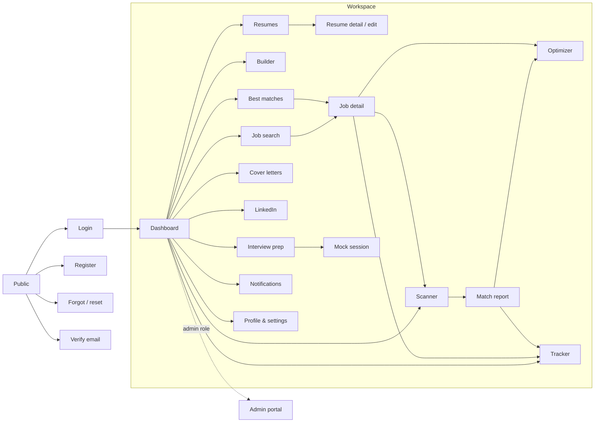

# Rolewise: UI/UX specification

**Rolewise** is a working product name, set in one place (`frontend/src/app/core/brand.ts`). Check trademark availability before launch.

## 1. Reference analysis and its limits

| Source | Access | What it gave us |
|---|---|---|
| `www.jobscan.co` marketing pages | Public | Feature set, top-level navigation, calls to action |
| `www.jobscan.co/jobscan-tutorial` | Public | Scan workflow, report sections, tracker columns |
| `app.jobscan.co/dashboard` | **Not accessible.** Returns a title only; the app is behind login | Nothing |

We have **not seen the authenticated app**. Any statement below about its layout comes from public documentation. If you can share screenshots, send them; they would refine layout decisions but are not needed for function.

### Observed workflow patterns (reimplemented in our own way)

- **Scan loop:** add resume → paste job description → read report → edit → rescan. Improvement comes from iterating.
- **Report grouping:** searchability, hard skills, soft skills, recruiter tips, formatting. Hard skills carry the most weight.
- **User control over the score:** a user can exclude an irrelevant skill, and the score recalculates.
- **Scan history links to tracker:** a scan can become a tracked application.
- **Tracker:** a column board. Cards hold resume, cover letter, interview details, notes and salary.
- **Marketing IA:** tools are grouped by artifact (resume, cover letter, LinkedIn), each with its own entry point.

### Where Rolewise deliberately differs

- Own name, palette, type scale, layouts, copy and icons. No Jobscan text, logo or asset is reused.
- Scoring rules are **visible and editable**: every score links to its formula, and admins can change weights.
- The report never implies that an employer's ATS produced the score, and never predicts hiring outcomes.
- AI output is always a **proposal**. Nothing reaches a resume until the user accepts it, and claims not found in the source resume are flagged for confirmation.
- Tracker adds an Assessment stage and a synced table view.

## 2. Design tokens

Single accent (deep teal-green), neutral slate surfaces, status colours used only for status. No gradients. All text pairs meet WCAG AA.

| Token | Light | Dark | Use |
|---|---|---|---|
| `--bg` | `#F6F7F8` | `#0F1214` | App background |
| `--surface` | `#FFFFFF` | `#171B1E` | Cards, tables, panels |
| `--surface-2` | `#F0F2F3` | `#1F2428` | Hover, inset areas |
| `--border` | `#E1E4E7` | `#2B3136` | Hairlines |
| `--text` | `#171C20` | `#ECEFF1` | Primary text |
| `--text-2` | `#55606A` | `#A3ADB5` | Secondary text |
| `--accent` | `#0B6E63` | `#3FBFAE` | Primary actions, links, focus |
| `--accent-soft` | `#E2F2EF` | `#15312D` | Selected nav, soft badges |
| `--success` | `#1B7A43` | `#4CC685` | Strong score, accepted, offer |
| `--warning` | `#A15C00` | `#E5A84B` | Moderate score, follow-up due |
| `--danger` | `#B3261E` | `#F2867E` | Weak score, destructive, rejected |
| `--info` | `#2B5FB8` | `#7FA8EE` | Neutral status |

- **Type:** Inter (400/500/600), with a system fallback. Scale: 12, 13, 14 (body), 16, 18, 22, 28.
- **Spacing:** 4 px base: 4, 8, 12, 16, 24, 32, 48.
- **Radius:** 6 inputs and buttons; 10 cards; 14 dialogs; 999 badges.
- **Elevation:** cards use a border, with `0 1px 2px rgb(0 0 0 / .04)`. Menus and dialogs get one larger shadow.
- **Motion:** 120–180 ms ease-out, disabled under `prefers-reduced-motion`.

## 3. Layout and responsive rules

| Breakpoint | Sidebar | Content |
|---|---|---|
| ≥ 1200 px | 240 px, collapsible to 64 px rail (remembered) | Max 1320 px; multi-column grids |
| 768–1199 px | 64 px rail | 2-column grids; report panes stack |
| < 768 px | Off-canvas drawer behind a header menu button | 1 column; 16 px gutter; board scrolls horizontally inside its own container; tables scroll inside their own container |

The page itself never scrolls horizontally. Touch targets are at least 40 px on small screens.

## 4. Navigation map

Sidebar groups: **Overview** (Dashboard) · **Resume** (Resumes, Scanner, Optimizer, Builder) · **Jobs** (Search, Best matches, Tracker) · **Prepare** (Cover letters, LinkedIn, Interview prep). Header: menu toggle, global job search, theme toggle, notifications, account menu.

## 5. Screen inventory

| Route | Screen | Primary content | Primary action | Empty / failure state |
|---|---|---|---|---|
| `/login` `/register` | Auth | Forms | Sign in / create account | Inline field errors |
| `/forgot-password` `/reset-password` `/verify-email` | Account recovery | Token forms | Send / reset | Expired-token message |
| `/dashboard` | Dashboard | KPIs, activity chart, scans, recommendations, interviews, follow-ups, timeline | Quick actions | Each widget has its own empty state with a next step |
| `/resumes` | Resume list | Cards with category, default marker, versions | Upload | "Upload your first resume" |
| `/resumes/:id` | Resume detail | Editable sections, text preview, version history | Save as new version | Parse-gap notice |
| `/scanner` | New scan + history | Resume picker or upload, company, title, description | Run scan | "No scans yet" |
| `/scanner/:id` | Match report | Scores, keywords, skills, warnings, side-by-side | Optimize / Track | Disclaimer always visible |
| `/optimizer` | Optimizer | Editor, suggestions, score delta, diff | Save version | AI-off notice; rule-based items still work |
| `/builder` `/builder/:id` | Builder | Section forms, ordering, live preview | Download | Template picker |
| `/jobs` | Job search | Filters, cards, pagination | Save / open | "No jobs synced" names the admin action |
| `/jobs/:id` | Job detail | Description, skills, company, match, source attribution | Apply externally | No-resume match prompt |
| `/matches` | Best matches | Ranked jobs with reasons and gaps | Open job | Needs a default resume |
| `/tracker` | Tracker | Board or table, follow-up strip | Add application | Column hints |
| `/cover-letters` `/cover-letters/:id` | Cover letters | Form, editor, versions | Generate / export | AI-off: clearly labelled template draft |
| `/linkedin` | LinkedIn | Manual profile form, analysis | Analyze | Rule-based checks without AI |
| `/interviews` `/interviews/session/:id` | Interview prep | Question bank, STAR guide, mock session | Start session | AI-off: bank plus rule checks |
| `/notifications` | Notifications | List, read state | Mark read | "All caught up" |
| `/profile` | Profile & settings | Profile, skills, preferences, password, sessions | Save | n/a |
| `/admin/*` | Admin portal | Overview, users, sources, categories, skills, plans, features, AI, scoring, logs, settings | Per page | Role-gated |

## 6. User journey

1. **Register** → verify email (in dev, the link is written to the server log unless SMTP is configured).
2. **Upload resume** → review the parsed sections → correct them → save.
3. **Scan** against a pasted job → read the report → see the formula behind each score.
4. **Optimize** → accept, edit or reject each suggestion → rescan → save a named version → download.
5. **Find jobs** → review the match reasons → save → add to tracker with the version attached.
6. **Apply** externally → drag the card through stages → set follow-ups → receive reminders.
7. **Prepare** a cover letter, LinkedIn updates and mock interviews.

## 7. Component inventory

`AppHeader`, `AppSidebar`, `DashboardLayout` (main-layout), `StatCard`, `DataTable`, `SearchBar`, `FilterPanel`, `JobCard`, `ResumeCard`, `ScoreIndicator`, `ProgressBar`, `StatusBadge`, `EmptyState`, `LoadingSkeleton`, `ConfirmationDialog`, `NotificationToast`, plus `ChartCanvas` and `AiNotice`.

Interaction rules: every destructive action confirms; every async action shows progress and a specific error; every list has empty, loading and error states; keyboard focus is always visible; drag and drop has a non-drag alternative (the stage menu on each card).

## 8. Functional requirements and honesty rules

Module requirements follow the master brief. These rules apply everywhere:

| ID | Rule | Enforced by |
|---|---|---|
| H1 | Scores are labelled as an estimate from our published rules, not an employer's ATS | Report and job UI; API `disclaimer` field |
| H2 | Match scores are never presented as a chance of being hired | Copy; `disclaimer` field |
| H3 | AI output is never faked. Without a provider, AI endpoints return `AI_UNAVAILABLE` | `AiService`; tests |
| H4 | Non-AI results are labelled `rule-based` or `template`, never "AI" | `source` field on results; UI badge |
| H5 | AI suggestions apply only after user acceptance; unverified claims need explicit confirmation | Suggestion state machine |
| H6 | Job listings show their source, with no "real-time" claim; demo data is badged | `job_sources`; `is_demo` |
| H7 | No scraping. Only documented APIs, within their terms | `JobProvider` adapters |
