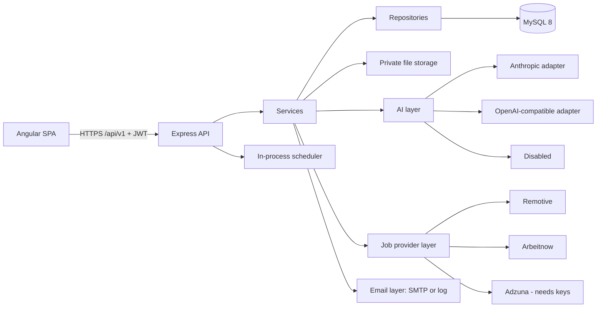
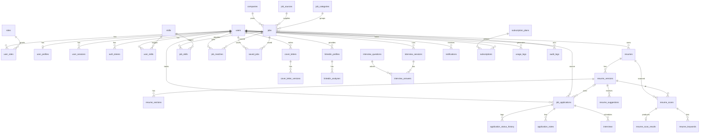

# Architecture

## System overview



Express can also serve the Angular build, so production can run as **one Node app on one origin**. This is the simplest fit for Hostinger's managed Node.js hosting, and it avoids cross-site cookies.

## Key decisions

| Decision | Choice | Why |
|---|---|---|
| Layers | controller → service → repository | Requested; keeps SQL out of business logic |
| SQL | Handwritten with `mysql2` prepared statements | Requested; no ORM needed |
| Migrations | Numbered SQL files with a small runner | Portable; can run with no extra tooling on hosted plans |
| Password hashing | `bcryptjs` (cost 12) | No native build, so it installs on restricted hosts |
| Sessions | 15-minute access JWT held in memory; rotating refresh token in an `HttpOnly`, `SameSite=Strict` cookie, stored hashed, with reuse detection | Limits XSS exposure and lets users revoke sessions |
| CSRF | Refresh and logout need a custom header plus `SameSite=Strict`; other routes use bearer tokens, which browsers don't attach automatically | Standard for this token model |
| Files | Private directory outside the web root; random names; served only through an ownership-checked route | PII protection |
| AI | One `AiProvider` interface, JSON validated with Zod, per-call usage logs, monthly per-plan limits | Provider independence, cost control |
| Scoring | Pure functions; weights in `system_settings`; each result stores its rules snapshot | Transparent, reproducible, testable |
| Jobs | `JobProvider` interface; a provider disabled by default until an admin enables it | Terms compliance is an explicit admin decision |
| Background work | In-process interval scheduler, guarded by a MySQL advisory lock | No Redis; works on managed hosts |

## ER diagram



The full DDL is in `backend/migrations/`. `system_settings` stands alone and holds scoring rules, feature flags, the active AI model and app settings.

**Soft deletes** apply to `users`, `resumes`, `job_applications` and `cover_letters`, which users may want restored within the retention window. Other tables hard-delete or cascade.

## AI layer

```ts
interface AiProvider {
  readonly name: string;
  isConfigured(): boolean;
  complete(req: AiRequest): Promise<AiCompletion>; // text + token usage
}
```

`AiService.generateJson(task, vars, zodSchema, ctx)` does the following:

1. Checks that the feature is enabled and the plan's monthly limit has room.
2. Renders the prompt template. Resume and job text is wrapped as data, and the prompt says to ignore instructions inside it.
3. Calls the provider, then validates the JSON with the schema, retrying once on invalid output.
4. Logs provider, model, tokens, estimated cost and status to `usage_logs`.
5. On failure, throws `AI_UNAVAILABLE` (503), `AI_LIMIT_REACHED` (429) or `AI_BAD_OUTPUT` (502). It never returns placeholder text.

Features that need generation report that AI is unavailable. Rule-based parts (scanner, matching, LinkedIn checks, the question bank) keep working and are labelled as rule-based.

## ATS scoring model

Default weights are in `system_settings.scoring_rules`, and admins can edit them:

| Sub-score | Weight | Calculation |
|---|---|---|
| Skills | 35% | Share of the job's hard skills found; required skills count double |
| Keywords | 20% | Share of top non-skill terms from the job found in the resume |
| Experience | 15% | Years evidenced vs years required, capped at 100; neutral 70 when the job states no requirement |
| Job title | 15% | Token overlap between target title and resume titles; exact phrase = 100 |
| Formatting | 10% | Starts at 100, minus listed deductions per finding |
| Education | 5% | Highest degree found vs required; neutral 100 when none is required |

Soft skills are reported, and count toward Skills at a configurable lower weight (0.5). The report stores the exact rules used, so old scans stay explainable after weights change.

## Job match model

Skills 40, experience 15, title 20, seniority 10, location/work mode 10, employment type 5. When an input is unknown, its weight is dropped and the rest renormalised, and the response lists what was unknown. Industry and qualifications contribute through the skill and keyword comparison.

## Security summary

Helmet with CSP; CORS allowlist; route-level rate limits with stricter auth limits; Zod on every body and query; prepared statements only; ownership in every user-data query (`WHERE user_id = ?`); upload checks on extension, MIME and file signature, with a size limit; private storage; generic login and reset responses; lockout after repeated failures; audit log for admin actions; retention job for soft-deleted data and old logs.
